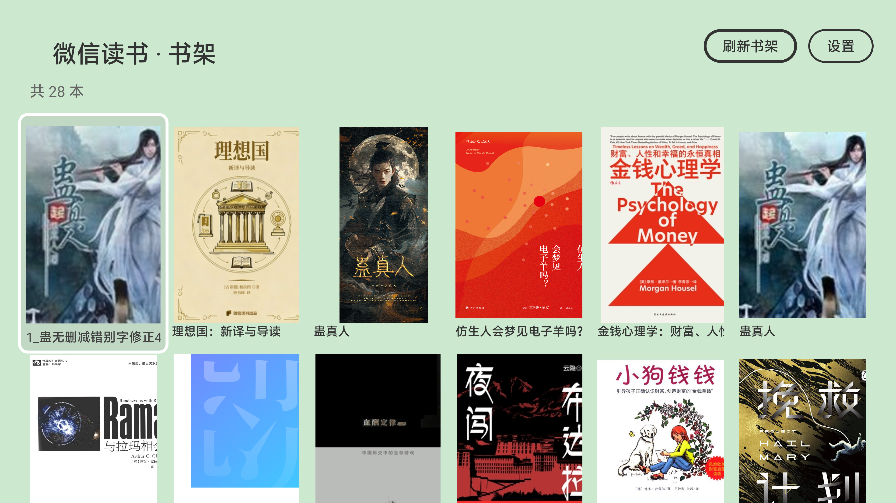
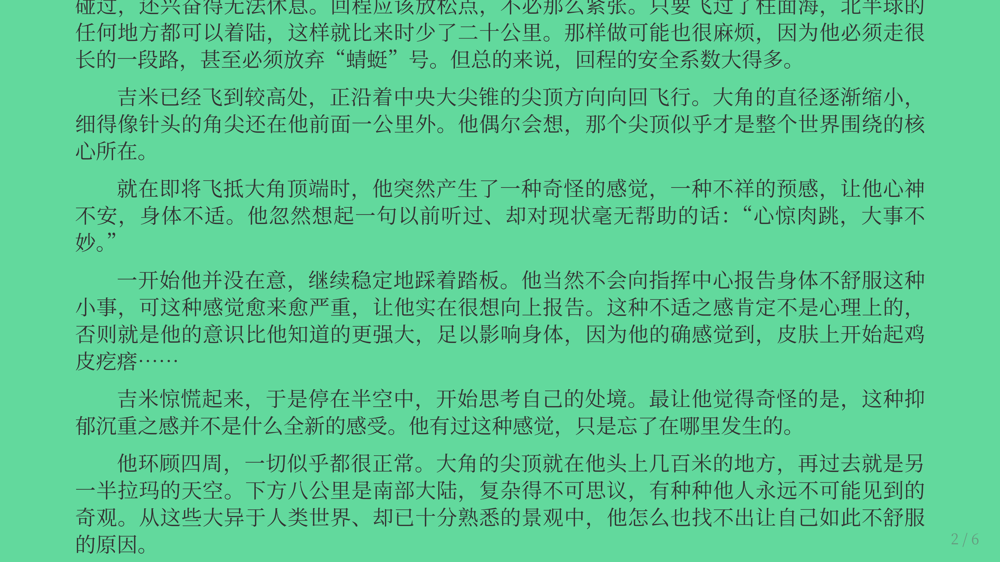
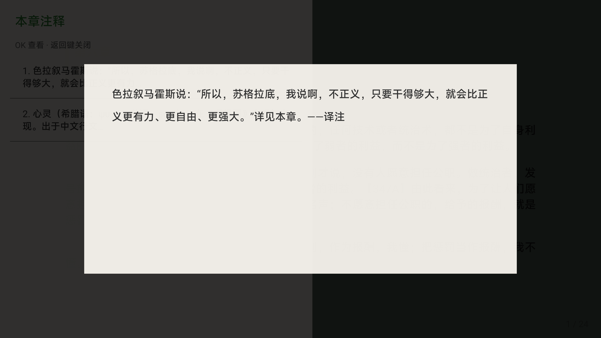
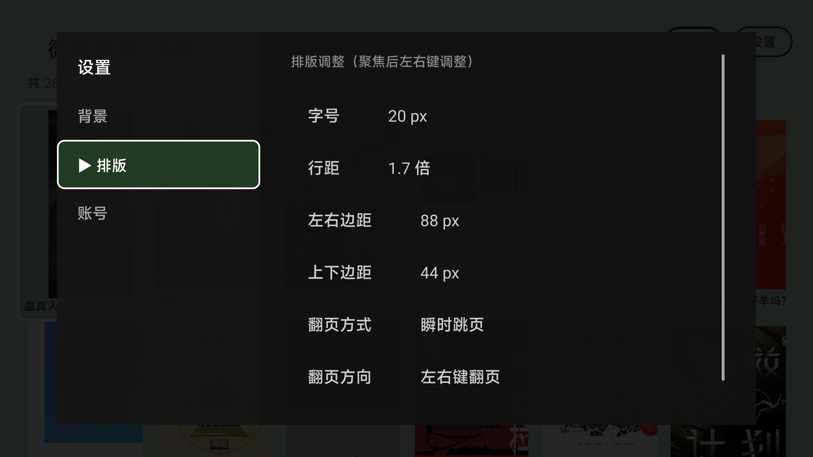

# WC reader

一个运行在 Android TV（及机顶盒/投影仪）上的第三方微信读书客户端，为遥控器阅读而设计。

> **声明：本项目为非官方客户端，仅供个人学习与技术研究使用。请勿用于商业用途或公开分发。**
> 详见文末[免责声明](#免责声明)。

## 为什么做这个

VSCode 上的 [TouchFish](https://github.com/ylw1997/touchFish) 插件把微信读书搬进了编辑器。本项目把它的微信读书模块复刻到了 Android TV 上，并针对**遥控器操作**和大屏阅读做了重新设计：

- 书架、阅读、进度云同步与官方服务器互通（手机读到哪，电视接着读）
- 翻页设计为**整页换页**：按行网格切分，任何一页都不会出现半行字
- 阅读界面支持主题（浅色/深色/任意自定义色）、字号、行距、页边距、翻页方向等排版调整
- 支持书内注释（脚注）浏览

## 界面

| 书架 | 阅读 |
|---|---|
|  |  |

| 注释 | 设置 |
|---|---|
|  |  |

## 功能

- 扫码登录（电视上显示二维码，手机微信扫码；支持验证码兜底）
- 书架浏览（按最近阅读排序，封面网格）
- 章节阅读：正文分页渲染、章节跳转、目录导航
- 阅读进度云同步（与官方服务器互通）
- Cookie 自动续期（长期不用掉登录）
- 章节预加载（翻章基本无等待）
- 书内注释：正文显示上标序号，长按 OK 或顶栏「注释」查看全文
- 主题：6 种预设色 + 2D 色盘自定义
- 排版：字号、行距、左右/上下页边距、翻页方式（平滑/瞬时）、翻页方向（左右/上下）、长按行为
- 账号面板：查看登录状态、刷新书架、退出登录

## 遥控器操作

| 操作 | 阅读页 | 书架页 |
|---|---|---|
| 方向键 | 翻页（章末继续按 → 下一章） | 移动焦点 |
| 长按方向键 | 跳到上一章 / 下一章（可在设置中改为连续快进） | — |
| OK | 呼出目录 | 打开书 |
| 长按 OK | 本章注释列表 | — |
| 返回键 | 第一次呼出顶栏（含提示）→ 再按回书架 | 退到桌面 |
| 菜单键 | 打开设置 | 打开设置 |

## 安装

### 方式一：ADB（推荐）

```bash
adb connect <电视IP>:5555   # 需先在电视上开启 ADB 调试
adb install WCReader-1.0.0.apk
```

### 方式二：U 盘

把 APK 拷到 U 盘，插入电视，用电视自带的文件管理器安装。

> 安装时如提示“未知来源”，请在系统设置中允许安装。

## 构建

需要 JDK 17 与 Android SDK（`local.properties` 中配置 `sdk.dir`）。

```bash
gradle assembleDebug
# 产物：app/build/outputs/apk/debug/app-debug.apk
```

## 技术说明

- 纯 Kotlin + Android SDK，无第三方运行时依赖（OkHttp 除外）
- 阅读正文使用 WebView 渲染，CSS 多栏布局实现真实分页（epub.js 同款机制）
- 接口与加解密算法移植自 TouchFish，并做过逐项对拍验证

## 参考项目

- [ylw1997/touchFish](https://github.com/ylw1997/touchFish) — 微信读书接口逆向、请求签名与章节解密算法均来自该项目（MIT License）
- [truefedex/tv-bro](https://github.com/truefedex/tv-bro) — Android TV 遥控器交互参考

## 免责声明

1. **非官方项目**：本项目与腾讯公司及「微信读书」无任何关联，不是官方客户端。
2. **仅供学习研究**：代码用于学习 Android TV 开发、WebView 排版与网络协议分析，请勿用于商业用途。
3. **请勿分发**：微信读书用户协议禁止使用第三方客户端访问其服务。请勿公开分发本应用或将其上传至任何应用商店，由此产生的一切后果由使用者自行承担。
4. **账号风险**：使用非官方客户端可能导致账号被风控，风险自负。
5. **接口稳定性**：本项目依赖微信读书 Web 端的非公开接口，官方更新可能导致功能失效，恕不保证持续可用。
6. **版权**：书籍内容版权归原作者及版权方所有，本项目不存储、不传播任何书籍内容。

## License

仅供学习交流，未授权任何商业使用。
